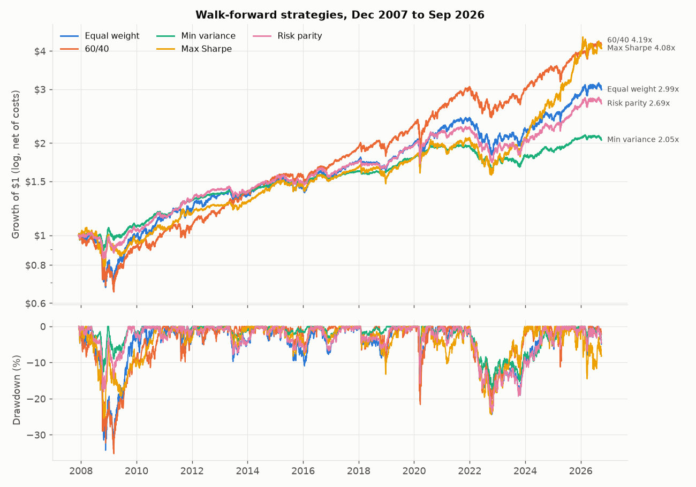
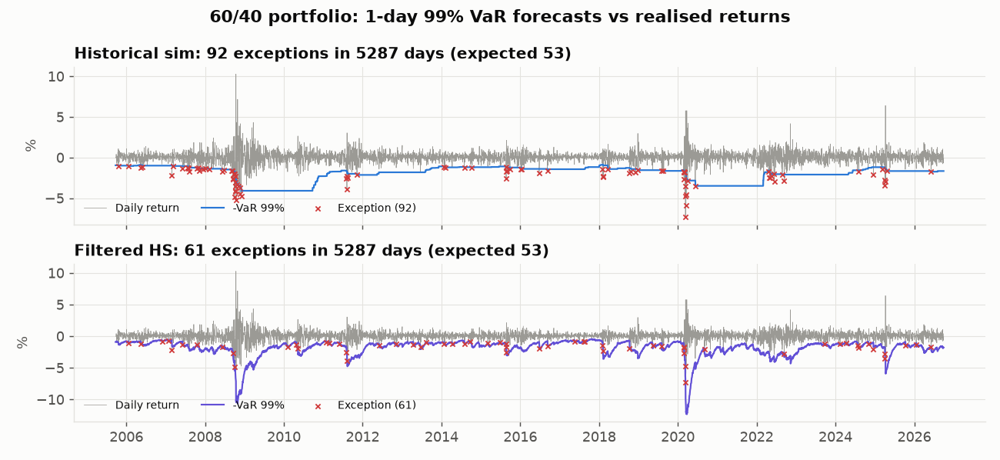
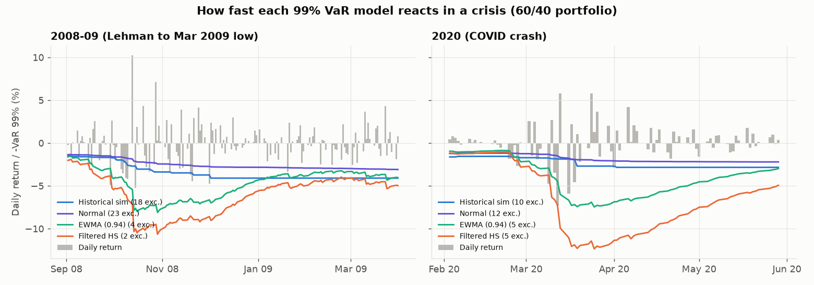

# Portfolio Risk Lab

**Question 1: do optimised portfolios beat simple ones once you test them honestly, out of sample?**
**Question 2: which Value-at-Risk model would a risk desk actually trust through 2008 and 2020?**

- Over December 2007 to September 2026 (walk-forward, net of 10 bps costs), Max Sharpe had the highest Sharpe ratio (0.63) and 60/40 came second (0.58), but **no strategy's Sharpe is statistically different from equal weight or 60/40**: every block-bootstrap p-value is 0.16 or higher, and Max Sharpe needed 238% annual turnover to get there.
- For 1-day 99% VaR on a 60/40 portfolio, **filtered historical simulation was the only model whose exception rate passed the Kupiec test** (61 exceptions vs 53 expected, p = 0.273) and the only one never in the Basel red zone. Plain historical simulation (92) and normal VaR (144) were red in both 2008 and 2020.



---

## Data

| | |
|---|---|
| Universe | SPY (US equity), EFA (developed ex-US), EEM (emerging), AGG (US aggregate bonds), TLT (long Treasuries), LQD (IG credit), GLD (gold), VNQ (US REITs) |
| Prices | Daily dividend- and split-adjusted closes from Yahoo Finance via `yfinance`, cached in `data/prices.csv` |
| Risk-free | FRED `DTB3` (3-month T-bill), cached in `data/dtb3.csv`; daily rate = DTB3 / 100 / 252 |
| Common sample | 5,499 daily returns, 2004-11-19 to 2026-09-30 (limited by GLD, first price 2004-11-18) |
| Out-of-sample backtest | 2007-12-03 to 2026-09-30, 4,736 days, 226 monthly rebalances |

DBC (commodities) was downloaded but left out of the universe. Its history starts 2006-02-06, so with a 3-year estimation window the first out-of-sample month would have been early 2009, after the worst of the financial crisis. I kept the 2008 test and dropped one asset.

## Method

**Portfolio construction** (`prl/optimize.py`, `prl/backtest.py`)

- On the last trading day of each month, each strategy uses only the trailing 756 daily returns (3 years) that are known at that close. It trades at that close, and the new weights earn returns from the next day. Between rebalances, weights drift with prices.
- All strategies are long-only and fully invested. The covariance matrix is Ledoit-Wolf (2004), which shrinks it toward a scaled identity (my own implementation, unit-tested).
  - **Equal weight**: 1/8 in each ETF.
  - **60/40**: 60% SPY, 40% AGG.
  - **Minimum variance**: min w'Σw.
  - **Maximum Sharpe**: tangency portfolio using the window's sample mean excess returns, solved as the convex problem min y'Σy s.t. μ'y = 1, y ≥ 0. The fallback to minimum variance (used when no asset has a positive expected excess return) was never triggered.
  - **Risk parity**: equal risk contribution, solved with Spinu's (2013) convex log-barrier formulation. Across all 226 rebalances, the largest risk contribution was at most 1.0000004 times the smallest (`results/summary.json`).
- Costs: 10 bps per unit of one-way traded notional. Turnover is the sum of |w_target − w_drifted|, annualised, and excludes the initial purchase.
- Sharpe and Sortino use daily excess returns over the T-bill rate, annualised by √252. Calmar = CAGR / |max drawdown|.
- Significance of Sharpe differences:
  - a **circular block bootstrap**: 5,000 resamples of 21-day blocks drawn jointly for both strategies, which keeps cross-correlation and volatility clustering;
  - the **Jobson-Korkie test with Memmel's correction** as an iid cross-check.

**VaR / ES** (`prl/var.py`)

- Portfolio: 60% SPY / 40% AGG held at constant weights. Returns run from 2003-09-30, and forecasts from 2005-09-23 to 2026-09-30 (5,287 days).
- Each forecast for day t uses data up to day t−1 only.
  - **Historical simulation**: empirical quantile of the last 500 returns.
  - **Parametric normal**: mean and standard deviation of the last 500 returns.
  - **EWMA**: RiskMetrics, λ = 0.94, zero mean, normal quantile.
  - **Filtered HS**: past returns are divided by their EWMA volatility. Take the empirical quantile of the last 500 of these standardised residuals and rescale it by today's EWMA volatility.
- ES is the mean loss beyond VaR under each model.
- Backtests:
  - **Kupiec POF** (is the exception rate right?);
  - **Christoffersen independence** (do exceptions cluster?) and conditional coverage;
  - the **Basel traffic light** (green 0–4, yellow 5–9, red 10+ exceptions per 250 days at 99%), evaluated on every rolling 250-day window.

## Results

### Strategies, net of costs (2007-12-03 to 2026-09-30)

| | CAGR | Vol | Sharpe | Sortino | Max DD | Calmar | Turnover/yr | $1 grows to |
|---|---|---|---|---|---|---|---|---|
| Equal weight | 6.00% | 11.74% | 0.43 | 0.62 | -34.3% | 0.18 | 30% | $2.99 |
| 60/40 | 7.92% | 11.87% | 0.58 | 0.82 | -35.2% | 0.22 | 20% | $4.19 |
| Min variance | 3.89% | 5.58% | 0.46 | 0.63 | -17.4% | 0.22 | 35% | $2.05 |
| Max Sharpe | 7.76% | 10.58% | 0.63 | 0.88 | -25.5% | 0.30 | 238% | $4.08 |
| Risk parity | 5.41% | 7.84% | 0.53 | 0.75 | -23.7% | 0.23 | 30% | $2.69 |

### Are the Sharpe differences real?

| | Sharpe diff | 95% bootstrap CI | bootstrap p | JK-Memmel p |
|---|---|---|---|---|
| 60/40 vs Equal weight | +0.15 | [-0.06, +0.36] | 0.16 | 0.18 |
| Min variance vs Equal weight | +0.02 | [-0.28, +0.34] | 0.89 | 0.91 |
| Max Sharpe vs Equal weight | +0.19 | [-0.17, +0.54] | 0.28 | 0.36 |
| Risk parity vs Equal weight | +0.10 | [-0.10, +0.30] | 0.35 | 0.43 |
| Min variance vs 60/40 | -0.13 | [-0.54, +0.29] | 0.55 | 0.59 |
| Max Sharpe vs 60/40 | +0.04 | [-0.40, +0.46] | 0.84 | 0.86 |
| Risk parity vs 60/40 | -0.05 | [-0.40, +0.28] | 0.76 | 0.77 |

No. Every confidence interval contains zero. After 19 years of daily data, the ranking of these five strategies is still mostly noise. The optimisers changed the shape of the risk, not the risk-adjusted return:

- Min variance and risk parity cut maximum drawdown from about 35% to 17–24%.
- In 2008, min variance returned +5.96% and risk parity -0.50%, against -21.15% for 60/40.

### The ranking flips between halves of the sample

| Sharpe | 2007-12 to 2017-04 | 2017-05 to 2026-09 |
|---|---|---|
| Equal weight | 0.44 | 0.43 |
| 60/40 | 0.53 | 0.63 |
| Min variance | 0.85 | 0.08 |
| Max Sharpe | 0.56 | 0.69 |
| Risk parity | 0.74 | 0.36 |

Min variance held 82% AGG on average, and risk parity held about 61% in the three bond ETFs. Both benefited from falling yields in the first half and were hurt by 2022 in the second (calendar 2022: min variance -12.46%, risk parity -17.34%, 60/40 -15.85%).

### VaR backtest, 99%, 60/40 portfolio (5,287 forecasts)

| | Exceptions / expected | Rate | Kupiec p | Christoffersen ind. p | Cond. coverage p | Loss / ES on exception days | Basel windows green / yellow / red | Worst 250d count |
|---|---|---|---|---|---|---|---|---|
| Historical sim | 92 / 53 | 1.74% | 0.000 | 0.000 | 0.000 | 1.06 | 62% / 24% / 14% | 23 |
| Normal | 144 / 53 | 2.72% | 0.000 | 0.000 | 0.000 | 1.34 | 46% / 23% / 31% | 31 |
| EWMA (0.94) | 118 / 53 | 2.23% | 0.000 | 0.067 | 0.000 | 1.20 | 27% / 67% / 6% | 12 |
| Filtered HS | 61 / 53 | 1.15% | 0.273 | 0.001 | 0.002 | 0.97 | 84% / 16% / 0% | 7 |

At 95%, all four models pass Kupiec (p from 0.057 to 0.504). Only EWMA (p = 0.213) and filtered HS (p = 0.257) also pass conditional coverage; historical simulation and normal VaR fail independence. Full results are in `results/var_backtest.csv`.

**2008 and 2020** (99% VaR exceptions; a calendar year is about 250 days, so the Basel zone applies directly):

| | 2008 | 2020 | Sep 2008 – Mar 2009 (exp. 1.5) | Feb – May 2020 (exp. 0.8) |
|---|---|---|---|---|
| Historical sim | 22 (red) | 11 (red) | 18 | 10 |
| Normal | 30 (red) | 13 (red) | 23 | 12 |
| EWMA (0.94) | 6 (yellow) | 10 (red) | 4 | 5 |
| Filtered HS | 3 (green) | 6 (yellow) | 2 | 5 |





Historical simulation and normal VaR use 500 equally weighted days, so they reacted to Lehman and COVID weeks late. Their exceptions bunched into the crisis, and that is why they fail the independence test. EWMA reacts quickly but uses a normal quantile, so it has too many exceptions at 99% even though it is fine at 95%. Filtered HS combines EWMA's speed with fat tails taken from the data.

## What did not work

- **Max Sharpe's edge is not robust.** Its Sharpe is 0.63 net and 0.65 gross. At 238% annual turnover, costs matter: at 50 bps its Sharpe drops to 0.53, below 60/40's 0.57 at the same cost (`results/sharpe_cost_sensitivity.csv`). It relies on sample-mean return forecasts, which are notoriously noisy. Its average holding was 32% SPY and 22% GLD, and its lead comes from the second half of the sample (Sharpe 0.56 in the first half, 0.69 in the second).
- **Minimum variance and risk parity did not improve risk-adjusted returns over the full period.** Without leverage they are mostly bond portfolios. Their crisis protection in 2008 did not repeat in 2022, when stocks and bonds fell together.
- **Ledoit-Wolf shrinkage barely mattered here.** With 8 assets and 756 observations, the estimated shrinkage intensity averaged 0.022 (range 0.0098 to 0.078). It is in the code because it matters for larger universes, but it did not change these results.
- **Filtered HS is the best VaR model but it is not perfect.** It still fails Christoffersen independence at 99% (p = 0.001). Exceptions still cluster when volatility jumps overnight, for example in March 2020 (5 exceptions in Feb–May 2020).
- **Normal VaR understates tail losses.** On exception days, its average realised loss was 1.34 times its own ES forecast at 99%.

## Limitations

- **One historical path and a hindsight-selected universe.** These are ETFs that exist and are liquid today. 19 years of data is not enough to separate Sharpe ratios that differ by about 0.1 to 0.2.
- **ETF market prices, not NAVs.** In the 2008 bond-market dislocation, AGG fell 6.84% on 2008-10-10 and LQD rose 9.77% on 2008-09-30. These moves are real traded prices but exaggerate fund-level risk.
- **Simplified trading.**
  - Trades execute at the same close used for the signal.
  - Costs are a flat 10 bps with no market impact.
  - There are no taxes, and cash is not held.
- **Simplified risk-free rate.** It is DTB3/252 on a discount basis, not converted to a bond-equivalent yield.
- **The VaR portfolio is not the backtested 60/40.** It is a constant-weight 60/40 (rebalanced daily), not the drifting monthly-rebalanced strategy above.
- **ES is only checked informally.** The loss-to-ES ratio on exception days is not a formal test (for example Acerbi-Szekely).
- **Fixed parameter choices.** The 500-day VaR window, λ = 0.94, and the 21-day bootstrap block are standard choices, not tuned, and I did not test sensitivity to them.

## How to run

```bash
make            # creates .venv, installs pinned requirements, runs run.py, runs pytest
# or
python3 -m venv .venv && .venv/bin/pip install -r requirements.txt
.venv/bin/python run.py      # about 10 seconds; writes results/ and figures/
.venv/bin/python -m pytest -q
```

- `run.py` uses the cached CSVs in `data/`. Delete them to re-download, in which case the numbers may shift slightly as Yahoo revises adjusted prices.
- Every table above is copied from `results/tables.md`, which `run.py` generates. The underlying numbers are in the CSVs in `results/`.
- Tests (`tests/test_core.py`) cover the core math:
  - risk contributions sum to portfolio volatility, and risk parity equalises them;
  - min-variance closed form for two assets;
  - Ledoit-Wolf properties;
  - historical and normal VaR/ES quantiles;
  - the EWMA recursion;
  - the Kupiec statistic on a hand-computed case (T = 1000, 20 exceptions, LR = 7.827);
  - Christoffersen on clustered vs spread exceptions;
  - Basel zones;
  - the Sharpe tests.

Built with Python 3.14, numpy, pandas, scipy, matplotlib and yfinance (versions in `requirements.txt`).

```
prl/data.py       download + cache prices and T-bill rate
prl/optimize.py   Ledoit-Wolf, min variance, max Sharpe, risk parity, risk contributions
prl/backtest.py   walk-forward monthly rebalancing with drift, turnover and costs
prl/metrics.py    performance metrics, block bootstrap and Jobson-Korkie-Memmel tests
prl/var.py        HS / normal / EWMA / filtered HS VaR and ES; Kupiec, Christoffersen, Basel
prl/plots.py      figures
run.py            runs everything
```

---

Every number here is produced by the code in this repo.
